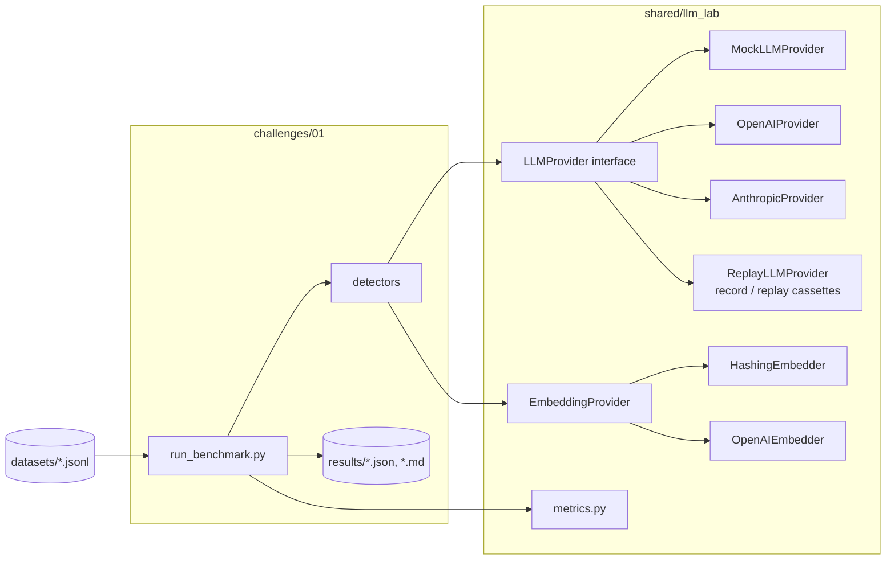

# llm-engineering-lab

Practical, reproducible engineering challenges for production LLM applications.

Each challenge takes one problem that shows up when you ship LLM features (hallucinations, evaluation, retrieval quality, prompt injection, cost, latency, reliability), builds a baseline and an improved solution, and measures the difference on a committed dataset. Everything runs offline with mocked model responses, so you can clone the repo and reproduce every committed number without an API key. Live runs against OpenAI or Anthropic are one flag away.

> **Results policy.** Every number in this repo is produced by running the code in this repo. Results from mocked providers are labelled **mock-run** and checked in CI. They test the pipeline, not model quality. Live results are labelled with provider and model, and they're only added when someone has actually run them.

## Challenges

| # | Challenge | Status | Core question |
|---|---|---|---|
| 01 | [Hallucination detection](challenges/01-hallucination-detection/) | ✅ Ready | Which detection method catches unsupported claims, and at what cost? |
| 02 | [LLM response evaluation](challenges/02-llm-evaluation/) | Planned | How do you build an eval suite you can trust? |
| 03 | [RAG retrieval](challenges/03-rag-retrieval/) | Planned | Does hybrid search or re-ranking actually improve answers? |
| 04 | [Chunking strategies](challenges/04-chunking-strategies/) | Planned | Fixed, recursive or semantic chunks: what changes recall? |
| 05 | [Prompt injection defense](challenges/05-prompt-injection/) | Planned | Which defenses hold up against a red-team set? |
| 06 | [Semantic caching](challenges/06-semantic-caching/) | Planned | How much cost can a Redis semantic cache save, and when does it return wrong answers? |
| 07 | [Rate limiting](challenges/07-rate-limiting/) | Planned | Token-bucket vs. sliding-window limits for LLM APIs |
| 08 | [Cost optimization](challenges/08-cost-optimization/) | Planned | Model routing, prompt compression and caching vs. quality |
| 09 | [Streaming](challenges/09-streaming/) | Planned | SSE streaming with FastAPI, backpressure and cancellation |
| 10 | [Multi-agent orchestration](challenges/10-multi-agent/) | Planned | When do multiple agents beat one? |
| 11 | [Fault tolerance](challenges/11-fault-tolerance/) | Planned | Retries, timeouts, circuit breakers and provider fallback |
| 12 | [Observability](challenges/12-observability/) | Planned | Tracing, token accounting and quality monitoring |

Challenges are built one at a time. Each one gets reviewed before the next one starts.

## Quick start

```bash
git clone https://github.com/aditya1501/llm-engineering-lab.git
cd llm-engineering-lab
python -m venv .venv && source .venv/bin/activate
pip install -e ".[dev]"

pytest                                   # all tests, fully offline
make bench-01                            # re-run the Challenge 01 mock benchmark
```

Live run (optional, costs money):

```bash
pip install -e ".[live]"
cp .env.example .env                     # add OPENAI_API_KEY and/or ANTHROPIC_API_KEY, then export them
python challenges/01-hallucination-detection/experiments/run_benchmark.py --provider anthropic --embedder openai
```

## Repository layout

```
llm-engineering-lab/
├── challenges/
│   ├── 01-hallucination-detection/
│   │   ├── README.md          # architecture, results, trade-offs, lessons
│   │   ├── problem.md         # real-world problem statement
│   │   ├── implementation/    # importable package (halludetect)
│   │   ├── experiments/       # dataset builder, benchmark runner
│   │   ├── results/           # generated results (never hand-edited)
│   │   ├── tests/
│   │   └── Dockerfile
│   └── 02-.../ ... 12-.../    # planned
├── datasets/                  # benchmark datasets (JSONL), versioned
├── benchmarks/                # cross-challenge results index
├── shared/llm_lab/            # provider abstractions, text utils, metrics
├── docs/                      # architecture and contributor docs
├── scripts/                   # repo tooling (result comparison, etc.)
└── tests/                     # tests for shared code
```

## Architecture



Design decisions, in short (details in [docs/architecture.md](docs/architecture.md)):

- **One small provider interface.** Challenges call `llm.complete(prompt, system)` and `embedder.embed(texts)`. Swapping OpenAI, Anthropic or a mock is a CLI flag. No framework dependency, so the code stays readable.
- **Mocks are first-class.** Every challenge ships a deterministic mock responder that reads the same prompts a real model gets and answers in the same format. Tests and CI never touch the network.
- **Record/replay for live runs.** `ReplayLLMProvider` records live responses to a JSONL cassette so a paid run can be replayed offline, byte for byte.
- **Results are artifacts, not prose.** Benchmarks write JSON and Markdown into `results/`. CI re-runs the mock benchmark and fails if the committed numbers drift from what the code produces.
- **Infrastructure only when a challenge needs it.** PostgreSQL, Redis and Docker Compose come in with the challenges that use them (Redis in 06 for caching and 07 for rate limiting, Postgres in 12 for traces). Challenge 01 needs neither, so it doesn't pull them in.

## Contributing

Issues and pull requests are welcome: new detection methods, harder dataset slices, live-run results, bug fixes. See [CONTRIBUTING.md](CONTRIBUTING.md).

## License

[MIT](LICENSE)
