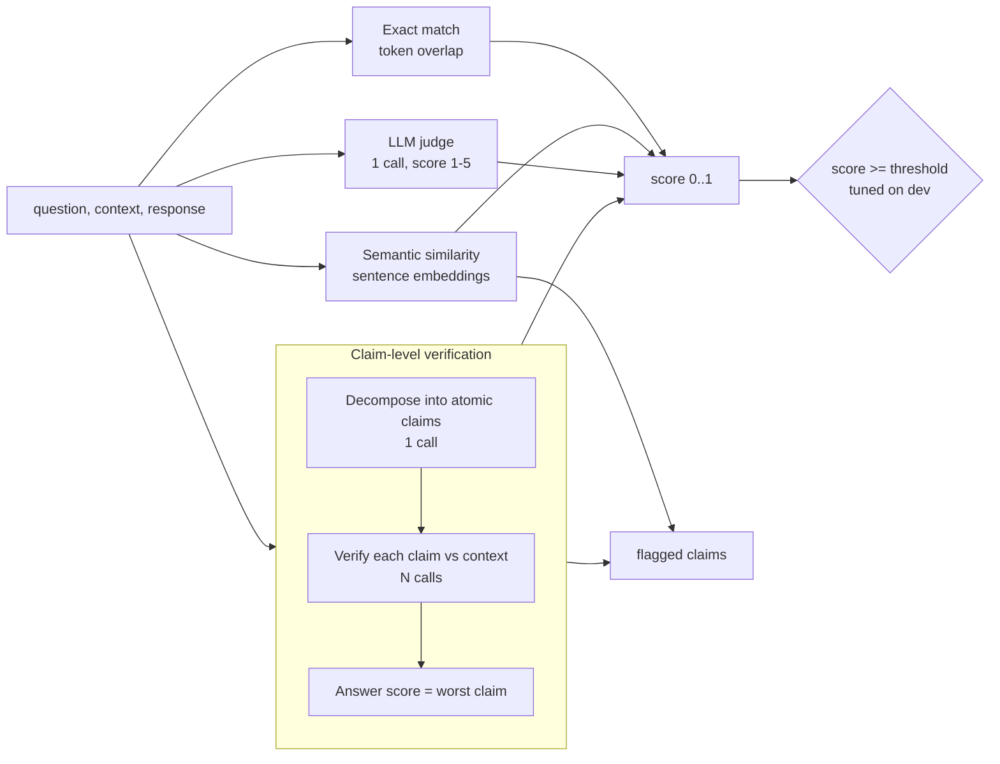

# Challenge 01: Hallucination detection

Detect answers that aren't supported by the context they were given, and find the exact claims that are unsupported. Four methods are compared on a 100-example labelled dataset: exact matching, semantic similarity, an LLM judge, and claim-level verification.

Read [problem.md](problem.md) for the real-world framing.

## Run it

From the repo root:

```bash
pip install -e ".[dev]"
pytest challenges/01-hallucination-detection          # offline tests
make dataset-01                                       # rebuild datasets/hallucination_qa/v1.jsonl
make bench-01                                         # mock benchmark -> results/mock-run.{json,md}
make api-01                                           # optional: FastAPI service on :8000
make docker-01                                        # tests + benchmark in a clean container
```

Live (needs keys, costs money):

```bash
pip install -e ".[live]"
export ANTHROPIC_API_KEY=... OPENAI_API_KEY=...
python challenges/01-hallucination-detection/experiments/run_benchmark.py \
    --provider anthropic --embedder openai --tag live-anthropic
python challenges/01-hallucination-detection/experiments/generate_responses.py --provider anthropic --limit 20
```

Try the API:

```bash
curl -s localhost:8000/detect -H 'content-type: application/json' -d '{
  "question": "What is the range?",
  "context": "The Vireo EV has a 77 kWh battery and an estimated range of 480 km.",
  "response": "The Vireo has a 77 kWh battery. Its range is 520 km.",
  "method": "claim_verification"}'
```

## Architecture



| Method | File | How it scores |
|---|---|---|
| Exact match (**baseline**) | [`detectors/exact_match.py`](implementation/halludetect/detectors/exact_match.py) | `1 - share of response content words found in context` |
| Semantic similarity | [`detectors/semantic.py`](implementation/halludetect/detectors/semantic.py) | Per response sentence, best cosine to any context sentence; `1 - min` |
| LLM judge | [`detectors/llm_judge.py`](implementation/halludetect/detectors/llm_judge.py) | Groundedness 1 to 5 mapped to `(5 - g) / 4` |
| Claim verification (**improved**) | [`detectors/claim_verification.py`](implementation/halludetect/detectors/claim_verification.py) | Decompose, label each claim supported / unsupported / contradicted, answer = worst claim |

Prompts live in [`prompts.py`](implementation/halludetect/prompts.py) and are versioned (`PROMPT_VERSION`). Model output is parsed by [`parsing.py`](implementation/halludetect/parsing.py), which tolerates code fences and surrounding prose. The judge and verifier **fail closed**: unparseable output counts as "not verified", because silently passing an answer is the worse failure.

### Offline mode

With `--provider mock` (the default), LLM calls go to [`mock_responders.py`](implementation/halludetect/mock_responders.py). Those functions read the real prompts and return JSON in the real format, using fixed heuristics: numbers missing from the context, share of content words found in the context, and negation mismatch against the best-matching context sentence. The holistic judge applies them to the whole answer at once; the claim verifier applies them per claim. Embeddings come from a hashing embedder (hashed word and character n-grams), which is lexical.

## Dataset

[`datasets/hallucination_qa/v1.jsonl`](../../datasets/hallucination_qa/v1.jsonl): 100 examples from 50 hand-written fictional contexts, each with a faithful answer and one hallucinated variant. Seven hallucination types: `unsupported_addition` (10), `number_change` (9), `entity_swap` (8), `negation` (7), `in_context_swap` (7), `overgeneralization` (6), `date_change` (3). Split 50 dev / 50 test by base item. Details and limitations are in [datasets/README.md](../../datasets/README.md).

## Metrics

- **Answer level:** precision, recall, F1, accuracy and ROC-AUC on the test split; false-positive rate on faithful answers.
- **Claim level:** precision and recall of flagged claims against gold unsupported claims (flagged claims are mapped to the closest gold claim by token Jaccard).
- **Recall by type:** which kinds of hallucination each method catches.
- **Cost:** LLM calls and tokens per example, mean latency.

Thresholds are picked on dev (max F1) and applied unchanged to test.

## Results

> **Mock run.** The table below is copied from [`results/mock-run.md`](results/mock-run.md), which `run_benchmark.py` generated. LLM calls were answered by the heuristic mock responders and embeddings came from the hashing embedder. These numbers show that the pipeline works end to end and how the *heuristics* behave. They are **not** measurements of GPT, Claude or any real model. No live run has been recorded yet.

Test split, 50 examples (25 faithful, 25 hallucinated):

| Method | Threshold | Precision | Recall | F1 | Accuracy | ROC-AUC | FPR on faithful | LLM calls / example |
|---|---|---|---|---|---|---|---|---|
| exact_match | 0.125 | 0.57 | 0.92 | 0.71 | 0.62 | 0.78 | 0.68 | 0.0 |
| semantic_similarity | 0.541 | 0.69 | 0.72 | 0.71 | 0.70 | 0.81 | 0.32 | 0.0 |
| llm_judge | 0.750 | 0.75 | 0.36 | 0.49 | 0.62 | 0.70 | 0.12 | 1.0 |
| claim_verification | 1.000 | 0.64 | 0.84 | 0.72 | 0.68 | 0.68 | 0.48 | 3.1 |

Claim level (test split):

| Method | Claim precision | Claim recall | Claim F1 |
|---|---|---|---|
| semantic_similarity | 0.53 | 0.64 | 0.58 |
| claim_verification | 0.50 | 0.76 | 0.60 |

Recall by hallucination type (test split, caught / total):

| Method | date_change | entity_swap | in_context_swap | negation | number_change | overgeneralization | unsupported_addition |
|---|---|---|---|---|---|---|---|
| exact_match | 1/1 | 4/4 | 3/4 | 2/3 | 1/1 | 4/4 | 8/8 |
| semantic_similarity | 1/1 | 4/4 | 2/4 | 0/3 | 0/1 | 3/4 | 8/8 |
| llm_judge | 1/1 | 2/4 | 0/4 | 0/3 | 1/1 | 1/4 | 4/8 |
| claim_verification | 1/1 | 4/4 | 3/4 | 1/3 | 1/1 | 4/4 | 7/8 |

Token counts for the mock run are estimates (characters / 4): 100 judge calls used about 26k input tokens; 311 claim-verification calls used about 55k. See [`results/mock-run.json`](results/mock-run.json).

With 50 test examples, one example moves accuracy by 2 points, and the per-type buckets hold one to eight examples. Treat differences smaller than about 10 points as noise.

## Trade-offs

| | Exact match | Semantic similarity | LLM judge | Claim verification |
|---|---|---|---|---|
| Cost per answer | ~0 | N embeddings | 1 call | 1 + N calls |
| Latency | microseconds | milliseconds | 1 round trip | 2 sequential round trips (claims can be verified in parallel) |
| Points at the bad claim | No | Yes (sentence) | No | Yes (atomic claim) |
| Handles paraphrase | No | With a neural embedder | Yes, with a real model | Yes, with a real model |
| Catches number/negation flips | Only if the new token is absent from context | Poorly: sentences stay similar | Depends on model | Best chance: one fact at a time |
| Failure mode | Flags every paraphrase | Misses swaps inside similar sentences | One bad claim gets averaged away | Decomposition errors, cost grows with answer length |
| Deterministic | Yes | Yes | No (sampling, model updates) | No |

## Lessons learned

**Observed in the mock run** (these hold for the heuristics in this repo; a live run is needed to say anything about real models):

1. **Lexical overlap can't tell a paraphrase from a fabrication.** To reach 0.92 recall, the exact-match baseline flagged 68% of faithful answers. Writing faithful claims as paraphrases ("swapped out" for "replaced") was enough to trip it.
2. **Holistic scoring hides one bad sentence among good ones.** The whole-answer judge had the lowest false-positive rate (0.12) and the lowest recall (0.36). Most answers have two good claims and one bad one, and a single score for the whole answer dilutes the bad one.
3. **Verifying one claim at a time raises recall, and it localizes the error.** Claim verification caught 0.84 of hallucinated answers and 0.76 of the individual unsupported claims, at about 3.1 LLM calls per answer instead of 1.
4. **Binary verdicts give a poor ranking.** Claim verification had the *lowest* ROC-AUC (0.68) despite the best F1, because each claim scores either 0 or 1, so there's no way to trade precision for recall. Graded confidence, or several sampled verdicts per claim, would fix that.
5. **Swaps within the context and negation flips were the hardest types for every method.** The wrong value is already in the context, so overlap-based signals see nothing new.
6. **Tokenization details move the metrics.** Two bugs were found while building this: `won` (as in "won the championship") was being read as the negation `won't`, and sentence splitting broke on "Dr.". Both made faithful claims look contradicted. Unit tests now cover both.

**Design reasoning** (not measured here):

- Prefer methods that return *which* claim is unsupported. A product can highlight, strip or regenerate one sentence, and a reviewer can check the verdict.
- Fail closed when the judge's output can't be parsed. A silent pass is the expensive mistake.
- Use cheap signals as a pre-filter. A new number that isn't in the context is a strong signal that costs nothing, so the expensive verifier can be saved for claims that need it.
- Calibrate thresholds on a held-out split, and re-calibrate whenever you change the model or the prompt.

## What's next for this challenge

- Record a live run with OpenAI and Anthropic and commit the replay cassettes.
- Ask the verifier for a confidence score and measure whether ROC-AUC improves.
- Add a cascade (cheap number/overlap check first, LLM only when unsure) and measure the calls saved.
- Add bootstrap confidence intervals to the report.
- Grow the dataset: longer answers, multiple errors per answer, multi-hop questions.
