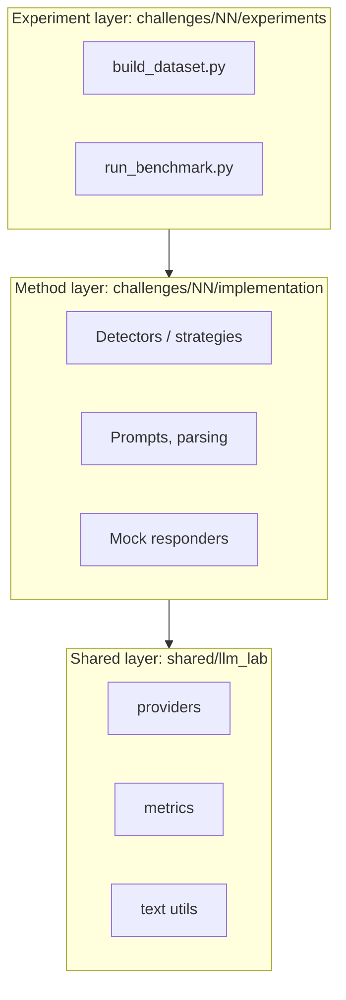

# Architecture

## Goals

1. A reader can understand any challenge without learning a framework.
2. Every committed number is reproducible offline, on a laptop, in seconds.
3. Moving from mock to a real provider requires no code changes.

## Layers



- **Shared layer** holds only what at least two challenges need. It has no knowledge of any challenge.
- **Method layer** is the interesting code. It depends on provider *interfaces*, never on a concrete provider.
- **Experiment layer** wires methods to data, runs them and writes results.

## Provider abstraction

```python
class LLMProvider:
    def complete(self, prompt: str, system: str | None = None, max_tokens: int = 1024) -> LLMResponse: ...
    def usage(self) -> dict: ...  # calls, input_tokens, output_tokens

class EmbeddingProvider:
    def embed(self, texts: list[str]) -> np.ndarray: ...  # L2-normalised rows
```

Why so small? Each challenge needs text in, text out, plus token accounting. Streaming (09), tool use (10) and retries (11) will extend the interface when those challenges need them, and each extension will be justified in that challenge's README.

Implementations:

| Provider | Use |
|---|---|
| `MockLLMProvider(responder)` | Tests and default benchmark. The responder is a plain function `(prompt, system) -> str`. |
| `ReplayLLMProvider(path, mode)` | Record a live run once, replay it forever. Replay fails loudly on a cache miss. |
| `OpenAIProvider`, `AnthropicProvider` | Live runs. Optional dependencies (`pip install -e ".[live]"`). Model set by flag or env var. |
| `HashingEmbedder` | Offline, deterministic embedding (hashed word and character n-grams). Lexical, not semantic. |
| `OpenAIEmbedder` | Live embeddings. |

## Mock responders: what they are and are not

A mock responder parses the same prompt a real model receives (inputs are wrapped in XML-style tags) and returns output in the same JSON format. That exercises prompt construction, output parsing, error handling, aggregation and metrics.

A mock responder is **not** a model. Its decisions come from simple heuristics written in advance. Benchmarks run on mocks measure those heuristics, so mock-run tables are labelled and never presented as model performance.

## Reproducibility

- Datasets are generated by a script that's committed next to its output.
- Benchmarks record dataset path, prompt version, git commit, Python version and timestamp.
- CI re-runs every mock benchmark and diffs it against the committed results with `scripts/compare_results.py`.

## Infrastructure

The stack named for the project (FastAPI, PostgreSQL, Redis, Docker) comes in per challenge:

| Component | First used in | Why there |
|---|---|---|
| FastAPI | 01 (optional `/detect` service) | Shows how a detector is served |
| Docker | 01 | Clean-room reproduction of tests and benchmark |
| Redis | 06, 07 | Semantic cache, distributed rate limiter |
| PostgreSQL | 12 | Trace and eval storage |
| docker-compose | 06 | First challenge with more than one service |
